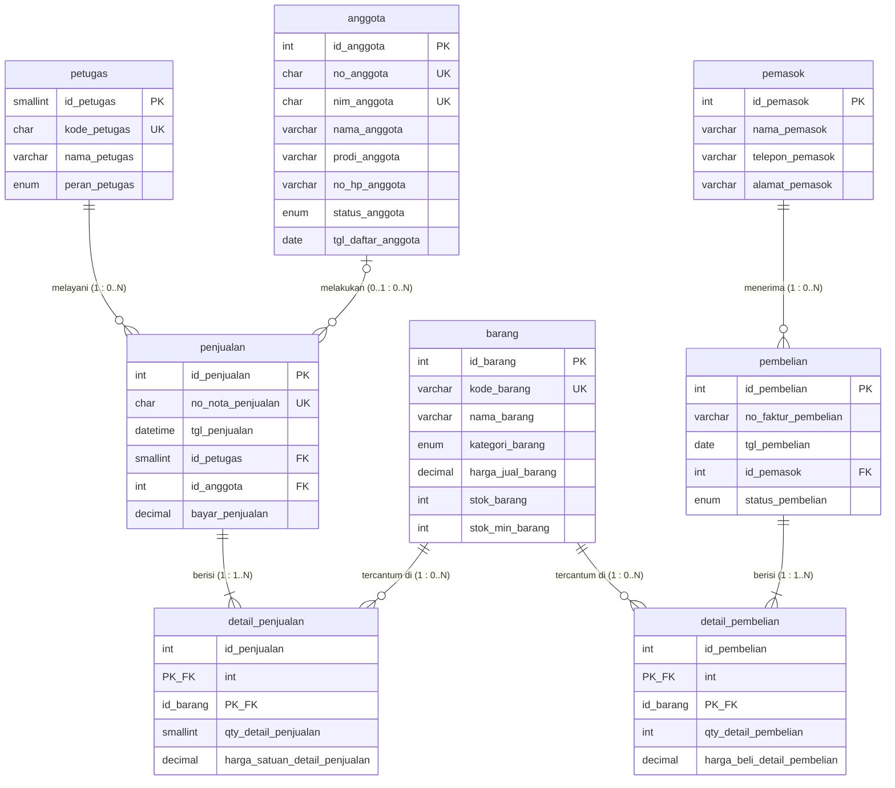
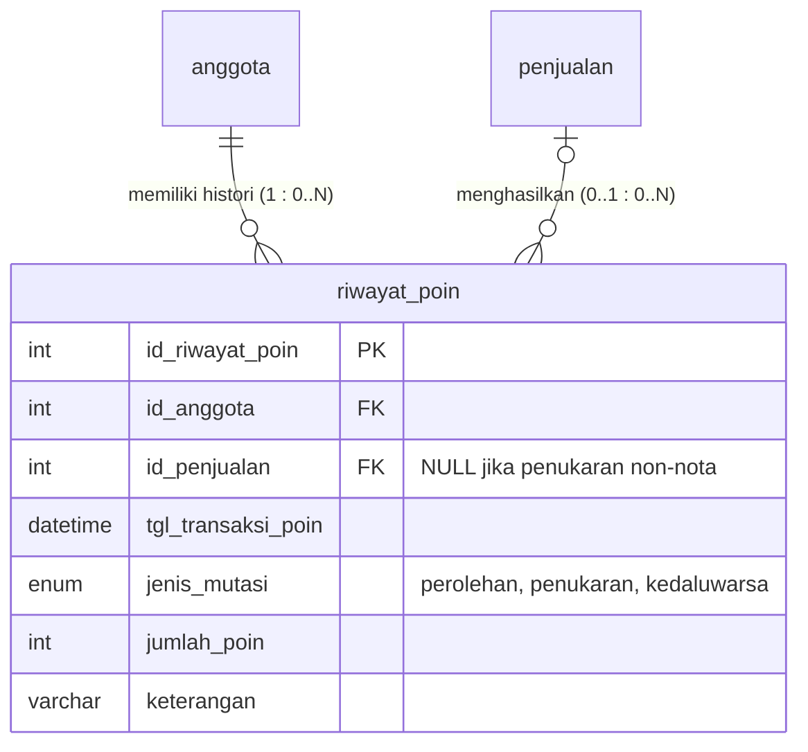
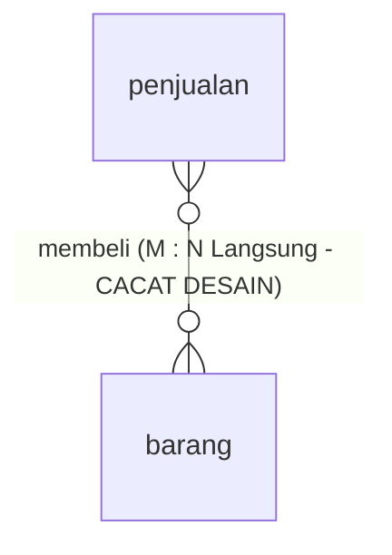
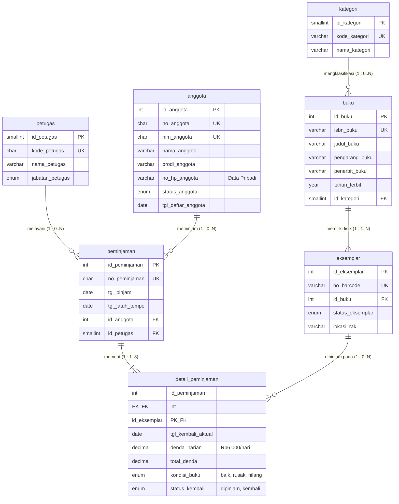

# Laporan Praktikum Basis Data - Pertemuan 03
**Nama:** Syifa  
**NIM:** 25430105  
**Kelas:** Basis Data Praktikum (Semester 3)  
**Tanggal:** 12 Oktober 2026  
**Dosen/Asisten:** Dedi Irawan, S.Kom., M.T.I.  

---

## 1. Tujuan Praktikum
Setelah menyelesaikan Modul 3 ini, praktikan mampu:
1. Mengidentifikasi entitas, atribut (kunci primer, kunci unik, kunci tamu, atribut deskriptif), dan tipe relasi dari dokumen analisis kebutuhan data.
2. Menentukan modalitas partisipasi serta derajat kardinalitas relasi menggunakan notasi Crow's Foot berlandaskan aturan bisnis yang baku.
3. Memecah relasi banyak-ke-banyak (*many-to-many*) menjadi entitas asosiatif guna menampung atribut data historis transaksi.
4. Memvalidasi rancangan Entity-Relationship Diagram (ERD) konseptual terhadap kebutuhan informasi (KI) dan mengevaluasi umpan balik tinjauan klien.

---

## 2. Ringkasan Dasar Teori
Entity-Relationship Diagram (ERD) merupakan representasi grafis tingkat konseptual yang memetakan objek data di dunia nyata beserta relasi yang mengikatnya. Pada tahap desain konseptual, perancangan difokuskan pada integritas struktur semantik dan batasan aturan organisasi (*business rules*), belum terikat pada sintaks platform RDBMS tertentu. Tiga pilar utama dalam pemodelan data ini mencakup:
1. **Entitas (*Entity*):** Objek konkret maupun kejadian transaksional yang datanya wajib disimpan oleh sistem (misalnya: `anggota`, `barang`, `penjualan`).
2. **Atribut (*Attribute*):** Karakteristik penyusun entitas yang mencakup kunci primer (*primary key* sebagai identitas baris tunggal unik), kunci alternatif/unik (*candidate/unique key*), kunci tamu (*foreign key* perujuk integritas referensial), serta atribut turunan (*derived attribute*) yang nilainya dapat dikalkulasi dari atribut lain.
3. **Kardinalitas dan Partisipasi (*Crow's Foot Notation*):** Menjelaskan keterikatan hubungan antarentitas. Kardinalitas menentukan jumlah maksimum instansi relasi (tepat satu atau banyak), sedangkan partisipasi/modalitas menentukan keterlibatan minimum (opsional `0` atau mandatori/wajib `1`). Relasi banyak-ke-banyak ($M:N$) tidak dapat diimplementasikan langsung pada basis data relasional karena memicu redundansi baris dan pelanggaran 1NF, sehingga wajib dinormalisasi melalui entitas asosiatif yang memuat kunci primer komposit ($PK, FK$) beserta atribut transaksionalnya.

---

## 3. Hasil Langkah Percobaan

### 3.1 Pemetaan Entitas dan Pemecahan Entitas Asosiatif (Langkah D.1)
Berdasarkan dokumen analisis kebutuhan data Koperasi Mahasiswa (Kopma), diidentifikasi 8 entitas utama. Relasi antara transaksi kepala (*header*) dan data barang dipecah menjadi entitas asosiatif:
- `penjualan` dan `barang` dihubungkan melalui entitas asosiatif `detail_penjualan` yang memuat `qty_detail_penjualan` dan `harga_satuan_detail_penjualan`.
- Entitas kandidat *"Pembelian dan detailnya"* dipecah menjadi entitas kepala `pembelian` dan entitas asosiatif `detail_pembelian` yang memuat `qty_detail_pembelian` dan `harga_beli_detail_pembelian`.

### 3.2 Tabel Relasi dan Kardinalitas Kopma (Langkah D.2)
Tabel berikut merangkum seluruh relasi, kardinalitas kedua sisi, serta aturan bisnis yang mendasarinya (Tabel 3.2 pada modul):

| Relasi | Sisi Kiri (Induk) | Sisi Kanan (Anak) | Dasar Aturan Bisnis |
| :--- | :--- | :--- | :--- |
| `petugas` melayani `penjualan` | Tepat satu petugas (`1`) | Nol atau banyak penjualan (`0..N`) | Wawancara kasir: Satu kasir dapat memproses banyak nota, namun satu nota wajib dicatat oleh tepat satu kasir. |
| `anggota` melakukan `penjualan` | Nol atau satu anggota (`0..1`) | Nol atau banyak penjualan (`0..N`) | **AB-02:** Penjualan boleh dilakukan oleh pembeli umum (non-anggota, bernilai `NULL`); jika anggota terdaftar, bisa berbelanja berkali-kali. |
| `penjualan` berisi `detail_penjualan` | Tepat satu penjualan (`1`) | Satu atau banyak detail (`1..N`) | **AB-01:** Setiap nota penjualan wajib memiliki nomor unik dan minimal satu baris item barang yang dibeli. |
| `barang` tercantum di `detail_penjualan` | Tepat satu barang (`1`) | Nol atau banyak detail (`0..N`) | **AB-04:** Satu jenis barang bisa belum pernah terjual (`0`) atau tercatat di berbagai nota penjualan (`N`). |
| `pemasok` menerima `pembelian` | Tepat satu pemasok (`1`) | Nol atau banyak pembelian (`0..N`) | **AB-06:** Satu faktur pengadaan ditujukan ke tepat satu pemasok; satu pemasok dapat menerima banyak pesanan pengadaan. |
| `pembelian` berisi `detail_pembelian` | Tepat satu pembelian (`1`) | Satu atau banyak detail (`1..N`) | Faktur pemasok: Setiap transaksi pembelian dari pemasok wajib memuat minimal satu rincian item barang pesanan. |
| `barang` tercantum di `detail_pembelian` | Tepat satu barang (`1`) | Nol atau banyak detail (`0..N`) | Faktur pemasok: Satu barang di katalog dapat dipesan berkali-kali atau belum pernah dipesan ulang. |

---

### 3.3 Diagram ERD Konseptual Notasi Crow's Foot Kopma (Langkah D.3)

Diagram konseptual ERD Kopma lengkap dirancang sesuai standar buku modul (Tabel 3.3) menggunakan notasi Crow's Foot:

#### Bukti Visual Tangkapan Layar:
1. **ERD Konseptual Notasi Crow's Foot Lengkap (Buku/Draw.io):**
   
   *Gambar 3.1: Diagram Relasi Entitas Kopma lengkap dengan atribut, kardinalitas Crow's Foot, dan tipe constraint.*

2. **Verifikasi Skema Relasional pada phpMyAdmin Designer (Identitas Personal Mahasiswa: SYIFA):**
   
   *Gambar 3.2: Tampilan antarmuka Designer phpMyAdmin untuk basis data `kopma_syifa` milik Syifa (NIM 25430105).*

3. **Verifikasi Eksekusi Skrip DDL Basis Data Kopma pada MariaDB:**
   
   *Gambar 3.3: Eksekusi pembuatan 8 tabel basis data Kopma pada server MariaDB lokal.*

---

### 3.4 Validasi ERD terhadap Kebutuhan Informasi (Langkah D.4)
Rancangan ERD telah divalidasi dan mampu menjawab seluruh Kebutuhan Informasi (KI) dari Modul 2 melalui penelusuran relasi:
- **KI-01 (Omzet dan jumlah nota per hari/bulan):** Jalur `penjualan` $\rightarrow$ `detail_penjualan`. Data tanggal agregasi diambil dari `penjualan.tgl_penjualan` dan total nominal dihitung dari `SUM(qty_detail_penjualan * harga_satuan_detail_penjualan)`.
- **KI-02 (Lima barang terlaris per bulan berdasar kuantitas):** Jalur `penjualan` $\rightarrow$ `detail_penjualan` $\rightarrow$ `barang`. Kueri menyaring rentang `penjualan.tgl_penjualan`, menjumlahkan `qty_detail_penjualan`, dan mengambil deskripsi dari `barang.nama_barang`.
- **KI-03 (Daftar barang dengan stok di bawah batas minimum):** Cukup menelusuri entitas `barang` secara langsung dengan klausa saring `WHERE stok_barang < stok_min_barang`.
- **KI-04 (Sepuluh anggota dengan akumulasi belanja terbesar):** Jalur `anggota` $\rightarrow$ `penjualan` $\rightarrow$ `detail_penjualan`. Menggabungkan profil anggota dengan total transaksi belanja yang dilakukan anggota aktif.

#### Catatan Tinjauan Klien (Evaluasi Umpan Balik KUK 1.3–1.5):
1. **Umpan Balik 1 (Ketua Kopma):** *"Bagaimana cara mengetahui petugas gudang yang menerima barang saat pengiriman dari pemasok tiba?"*  
   **Keputusan & Alasan:** **Diterima**. Pada ERD saat ini, entitas `pembelian` baru merujuk `pemasok`. Untuk memenuhi audit akuntabilitas penerimaan stok barang, foreign key `id_petugas` perlu ditambahkan ke entitas `pembelian` (aturan bisnis AB-07 baru).
2. **Umpan Balik 2 (Kasir Senior):** *"Mengapa nilai subtotal dan total tidak dicatat langsung di tabel nota penjualan?"*  
   **Keputusan & Alasan:** **Ditolak untuk tabel operasional**. Nilai subtotal dan total merupakan atribut turunan (*derived attribute*). Sesuai prinsip normalisasi (Modul 4), menyimpan total pada tabel transaksi operasional berisiko memicu anomali inkonsistensi jika kuantitas barang berubah. Total dihitung secara dinamis saat kueri dieksekusi.

---

## 4. Jawaban Titik Analisis

### Titik Analisis 1: Kunci Primer Alami vs Kunci Pengganti (*Surrogate Key*)
**Pertanyaan:**  
`no_anggota` dan `nim_anggota` sama-sama unik. Mengapa buku ini tetap memakai `id_anggota` sebagai kunci primer? Sebutkan satu risiko jika NIM dijadikan kunci primer!

**Jawaban:**  
1. **Alasan Penggunaan `id_anggota` (Surrogate Key):**
   - **Efisiensi Kinerja dan Ukuran Penyimpanan:** `id_anggota` bertipe numerik integer (`INT AUTO_INCREMENT`), yang membutuhkan ruang penyimpanan jauh lebih kecil (4 byte) dibandingkan string/karakter (`CHAR(10)` untuk NIM). Pengindeksan pohon B (*B-Tree index*) dan operasi pencarian relasi foreign key pada baris jutaan transaksi jauh lebih cepat menggunakan integer.
   - **Kekekalan (*Immutability*):** Kunci primer yang baik harus bernilai tetap dan tidak bergantung pada entitas eksternal. Nilai angka auto-increment internal sistem dijamin tidak akan pernah mengalami perubahan logika bisnis.
2. **Risiko Jika `nim_anggota` Dijadikan Kunci Primer:**
   - **Ketergantungan terhadap Pihak Eksternal:** NIM diterbitkan oleh administrasi universitas di luar otoritas Kopma. Apabila institusi kampus merestrukturisasi format penomoran NIM atau terjadi salah entri data saat registrasi awal, perubahan satu nilai NIM pada baris induk `anggota` akan memicu *cascading update* ke ribuan rekaman historis penjualan yang merujuknya. Beban IO server meningkat drastis dan berisiko memicu integritas gantung (*orphaned records*).
   - **Ketidakmampuan Mengakomodasi Anggota Non-Mahasiswa:** Jika di masa depan Kopma menerima staf kependidikan, dosen, atau karyawan kontrak yang tidak memiliki NIM kampus, baris data mereka tidak dapat disimpan karena kolom Primary Key mutlak menolak nilai `NULL`.

---

### Titik Analisis 2: Kardinalitas Mandatori Sisi Anak (*1..N*)
**Pertanyaan:**  
Sisi penjualan terhadap `detail_penjualan` bernilai *satu atau banyak* (`1..N`), bukan *nol atau banyak* (`0..N`). Aturan bisnis mana yang memaksanya? Apakah aturan “minimal satu” ini dapat dijaga oleh struktur tabel saja? Simpan jawaban Anda; Modul 14 akan menjawabnya dengan transaksi.

**Jawaban:**  
1. **Aturan Bisnis yang Memaksa:**  
   Aturan bisnis **AB-01**: *"Setiap nota memiliki nomor unik dan minimal satu baris barang."* Dalam realitas fisik transaksi kasir, sebuah nota penjualan mustahil diterbitkan tanpa ada setidaknya satu barang belanjaan yang dibeli.
2. **Daya Jangkau Struktur Tabel (DDL/Constraint):**  
   Aturan "minimal satu" ini **TIDAK BISA** dijaga hanya dengan mengandalkan struktur tabel dan constraint foreign key DDL.
   - **Penyebab Teknis:** Dalam basis data relasional, foreign key berada di tabel anak (`detail_penjualan.id_penjualan` merujuk ke `penjualan.id_penjualan`).
   - Saat aplikasi melakukan proses simpan, baris induk (`penjualan`) harus di-`INSERT` terlebih dahulu sebelum detailnya dapat di-`INSERT`.
   - Pada interval mikrodetik ketika baris `penjualan` berhasil masuk, jumlah baris `detail_penjualan` masih $0$. MariaDB tidak memiliki constraint bawaan pada tabel induk yang sanggup menolak baris induk jika belum memiliki pasangan di tabel anak.
   - Penegakan integritas ini mutlak membutuhkan kontrol **Transaksi ACID (Modul 14)**: seluruh rangkaian `INSERT` kepala nota dan rincian item dibungkus dalam blok `START TRANSACTION;` dan jika tidak ada baris detail yang valid, sistem mengeksekusi `ROLLBACK;`.

---

### Titik Analisis 3: Keterlacakan Alur Pengadaan Barang Gudang
**Pertanyaan:**  
Ketua ingin mengetahui “petugas gudang mana yang menerima barang dari pemasok”. Apakah ERD saat ini dapat menjawabnya? Jika belum, relasi apa yang perlu ditambahkan, dan apakah keputusan itu perlu dicatat sebagai aturan bisnis baru?

**Jawaban:**  
1. **Analisis ERD Eksisting:**  
   ERD Kopma saat ini **BELUM BISA** menjawab pertanyaan tersebut. Pada diagram Gambar 3.2, entitas `petugas` hanya dihubungkan dengan transaksi `penjualan` (kasir), sedangkan entitas `pembelian` hanya menampung foreign key `id_pemasok`. Sistem mencatat nomor faktur dan tanggal kedatangan barang, tetapi kehilangan jejak siapa petugas gudang yang menandatangani serah terima barang tersebut.
2. **Relasi yang Wajib Ditambahkan:**  
   Perlu ditambahkan relasi langsung antara `petugas` dengan `pembelian`:  
   **"petugas gudang menerima/mencatat pembelian"**  
   - Kardinalitas: `petugas (1)` $\longleftrightarrow$ `(0..N) pembelian`.  
   - Satu orang petugas gudang dapat memverifikasi banyak faktur pembelian dari pemasok, dan satu transaksi pembelian diverifikasi oleh tepat satu petugas gudang.
   - Pada desain fisik, tabel `pembelian` ditambah kolom `id_petugas SMALLINT NOT NULL` sebagai foreign key ke tabel `petugas`.
3. **Pencatatan Aturan Bisnis Baru:**  
   Ya, keputusan ini **wajib dicatat sebagai aturan bisnis baru**, yaitu:  
   - **AB-07:** *"Setiap faktur pembelian dan penerimaan barang dari pemasok wajib mencatat identitas petugas gudang yang berwenang memeriksa dan memasukkan stok ke sistem."*

---

## 5. Hasil Latihan dan Modifikasi

### 5.1 Latihan E.1: Pemodelan Poin Loyalitas Anggota Kopma
**Permasalahan:**  
Setiap kelipatan belanja Rp10.000 anggota memperoleh 1 poin, dan 50 poin dapat ditukarkan dengan potongan tunai Rp5.000.  
**Keputusan Desain & Argumentasi Teknis:**  
Untuk mengakomodasi poin loyalitas, sistem tidak boleh sekadar menambahkan kolom saldo `poin_anggota` pada tabel `anggota`. Sistem harus mengimplementasikan entitas baru bernama **`riwayat_poin`** (*transaksi poin*):

**Alasan Mengapa Wajib Entitas Riwayat Poin (Bukan Sekadar Atribut):**
1. **Auditabilitas Finansial & Pencegahan Fraud:** Poin memiliki nilai ekonomis riil yang mengurangi pendapatan tunai kasir. Jika hanya berupa angka saldo di entitas `anggota`, manajemen tidak memiliki jejak bukti transaksi mana yang menerbitkan poin dan kapan penukaran terjadi.
2. **Rekonsiliasi Integritas Saldo:** Saldo poin aktif anggota adalah akumulasi kalkulatif dari seluruh mutasi kredit dan debit (`SUM(jumlah_poin)`). Dengan entitas log riwayat, integritas data tetap terjaga meskipun terjadi koreksi transaksi nota yang dibatalkan.

**Aturan Bisnis dan Kebutuhan Informasi Tambahan:**
- **AB-07 (Perolehan Poin):** Anggota berstatus aktif memperoleh 1 poin untuk setiap nominal belanja kelipatan Rp10.000 pada nota penjualan yang sah.
- **AB-08 (Penukaran Poin):** Penukaran saldo minimal 50 poin bernilai diskon belanja Rp5.000 dan langsung mendebit saldo pada `riwayat_poin`.
- **KI-05:** Laporan saldo dan daftar 10 anggota pengumpul poin terbanyak per periode.

---

### 5.2 Latihan E.2: Pembuktian Data yang Hilang Jika Relasi Penjualan–Barang Dibuat M:N Langsung
Jika relasi antara `penjualan` dan `barang` digambar sebagai Many-to-Many langsung tanpa entitas asosiatif `detail_penjualan`:

**Daftar Elemen Data Kritis yang Hilang (*Data Loss*):**
1. **Kuantitas Barang Terjual (`qty_detail_penjualan`):** Tanpa tabel penghubung beratribut, sistem hanya mencatat bahwa dalam nota tersebut "terdapat barang pulpen", tetapi tidak sanggup menyimpan informasi apakah pelanggan membeli 1, 5, atau 100 pulpen.
2. **Harga Historis Transaksi (`harga_satuan_detail_penjualan` - Pelanggaran AB-04):** Harga transaksi tidak dapat disimpan di `penjualan` (karena satu nota memuat banyak barang berbeda jenis) dan tidak bisa disimpan di `barang` (karena harga di tabel barang selalu diperbarui ke harga pasar terkini). Akibatnya, saat harga pulpen naik minggu depan, kalkulasi omzet nota masa lalu ikut berubah, merusak laporan keuangan historis.
3. **Subtotal per Baris Item:** Perhitungan nominal belanja per rincian barang menjadi hilang.
4. **Pelanggaran Bentuk Normal Pertama (1NF):** Basis data relasional tidak mengizinkan kolom berisi *multivalued attributes* (grup berulang). Relasi $M:N$ fisik tanpa tabel asosiatif akan memaksa penyimpanan deretan kode barang berulang dalam satu baris, menciptakan anomali pembaruan dan integritas.

---

## 6. Tugas Mandiri: Milestone Proyek 3

### 6.1 Identitas dan Parameter Proyek Pribadi
- **Nama Organisasi Fiktif:** **Perpustakaan Cendekia Syifa** (memuat inisial personal Syifa dan nomor identitas mahasiswa).
- **Tema Proyek (Sesuai 2 Digit Akhir NIM: `05`):** **Perpustakaan** (`perpus_105`).
- **Perhitungan Parameter Personal $P$:**
  $$P = (\text{2 digit terakhir NIM} \pmod 9) + 1 = (05 \pmod 9) + 1 = 5 + 1 = 6$$
- **Implementasi Nilai Parameter $P = 6$:**
  - Batas maksimal eksemplar buku per transaksi peminjaman: $P + 2 = 6 + 2 = \mathbf{8\text{ eksemplar buku}}$.
  - Besaran tarif denda keterlambatan per hari: $P\text{ ribu rupiah} = \mathbf{Rp6.000\text{ / hari / buku}}$.
  - Perkiraan volume transaksi peminjaman harian: $40 + (5 \times P) = 40 + (5 \times 6) = \mathbf{70\text{ transaksi / hari}}$.

---

### 6.2 Aturan Bisnis Proyek Perpustakaan (AB-01 s.d AB-08)
- **AB-01:** Setiap transaksi peminjaman memiliki kode registrasi unik, tanggal peminjaman, tanggal jatuh tempo, dan dilayani oleh tepat satu petugas sirkulasi.
- **AB-02:** Peminjaman buku hanya dapat diproses apabila anggota memiliki status keanggotaan aktif dan tidak sedang terkena sanksi pembekuan (*suspend*).
- **AB-03:** Setiap satu transaksi peminjaman dibatasi maksimal meminjam sebanyak 8 eksemplar buku ($P+2$) dan minimal 1 eksemplar buku.
- **AB-04:** Satu judul pustaka induk dapat memiliki satu atau banyak eksemplar fisik dengan nomor barcode register yang bersifat unik.
- **AB-05:** Setiap keterlambatan pengembalian buku dikenakan denda akumulatif sebesar Rp6.000 per hari keterlambatan untuk setiap eksemplar buku ($P$ ribu rupiah).
- **AB-06:** Anggota perpustakaan diidentifikasi melalui nomor anggota unik berformat `LIB-xxxx` dan nomor induk mahasiswa/pegawai (NIM/NIP) yang unik 10 digit.
- **AB-07:** Eksemplar buku yang sedang dalam masa peminjaman berstatus 'dipinjam' dan tidak dapat dipinjam oleh peminjam lain hingga buku dikembalikan.
- **AB-08:** Setiap pengembalian eksemplar buku mencatat kondisi fisik buku (baik/rusak/hilang), tanggal pengembalian aktual, serta denda riil yang dibayarkan.

---

### 6.3 Tabel Relasi dan Kardinalitas Proyek Perpustakaan

| Relasi | Sisi Kiri (Induk) | Sisi Kanan (Anak) | Dasar Aturan Bisnis |
| :--- | :--- | :--- | :--- |
| `petugas` melayani `peminjaman` | Tepat satu petugas (`1`) | Nol atau banyak peminjaman (`0..N`) | **AB-01:** Satu staf sirkulasi melayani banyak peminjaman harian; satu transaksi peminjaman wajib dicatat satu petugas penanggung jawab. |
| `anggota` meminjam `peminjaman` | Tepat satu anggota (`1`) | Nol atau banyak peminjaman (`0..N`) | **AB-02:** Peminjaman wajib atas nama satu anggota aktif; satu anggota dapat melakukan transaksi peminjaman berulang kali. |
| `peminjaman` memuat `detail_peminjaman` | Tepat satu peminjaman (`1`) | Satu atau banyak detail (`1..N`) | **AB-03:** Peminjaman wajib memuat minimal 1 buku dan maksimal 8 buku ($P+2$). Dipecah melalui entitas asosiatif. |
| `eksemplar` dipinjam pada `detail_peminjaman` | Tepat satu eksemplar (`1`) | Nol atau banyak detail (`0..N`) | **AB-07:** Satu fisik barcode eksemplar dapat tercatat di berbagai riwayat peminjaman dalam kurun waktu berbeda. |
| `buku` memiliki `eksemplar` | Tepat satu judul buku (`1`) | Satu atau banyak eksemplar fisik (`1..N`) | **AB-04:** Setiap entri katalog pustaka harus memiliki minimal satu fisik eksemplar yang teregistrasi di rak. |
| `kategori` mengklasifikasikan `buku` | Tepat satu kategori (`1`) | Nol atau banyak buku (`0..N`) | Standar katalog: Satu kategori rak (misal: Komputer) menaungi banyak judul buku. |

---

### 6.4 Pemetaan Jalur ERD terhadap Kebutuhan Informasi (KI Proyek)

| Kode KI | Kebutuhan Informasi Proyek | Jalur Penelusuran Entitas pada ERD |
| :--- | :--- | :--- |
| **KI-01** | Rekapitulasi volume transaksi peminjaman per hari dan per petugas sirkulasi | `petugas` $\rightarrow$ `peminjaman` $\rightarrow$ `detail_peminjaman` |
| **KI-02** | Daftar 5 judul buku paling sering dipinjam per semester | `buku` $\rightarrow$ `eksemplar` $\rightarrow$ `detail_peminjaman` $\rightarrow$ `peminjaman` |
| **KI-03** | Daftar eksemplar buku yang melewati batas jatuh tempo (terlambat) | `peminjaman` $\rightarrow$ `detail_peminjaman` $\rightarrow$ `eksemplar` $\rightarrow$ `buku` |
| **KI-04** | Total penerimaan denda keterlambatan per bulan | `peminjaman` $\rightarrow$ `detail_peminjaman` (menghitung `SUM(total_denda)`) |
| **KI-05** | Sepuluh anggota teraktif dengan frekuensi peminjaman tertinggi | `anggota` $\rightarrow$ `peminjaman` $\rightarrow$ `detail_peminjaman` |

---

### 6.5 Diagram ERD Konseptual Proyek Pribadi (Perpustakaan Cendekia Syifa)

*Berkas sumber diagram tersimpan di repositori sebagai [p03_erd_25430105.drawio](file:///d:/SEMESTER%203/BASIS%20DATA/modul3/p03_erd_25430105.drawio) dan [p03_erd_kopma_25430105.drawio](file:///d:/SEMESTER%203/BASIS%20DATA/modul3/p03_erd_kopma_25430105.drawio).*

#### Catatan Tinjauan Klien Proyek Perpustakaan (Umpan Balik Teman Praktikum):
1. **Umpan Balik Penguji 1 (Peran: Kepala Bagian Koleksi Pustaka):**  
   *"Apakah satu judul buku yang memiliki 5 cetakan buku yang sama ditaruh dalam 5 baris di entitas buku?"*  
   **Keputusan & Alasan:** **Ditolak**. Satu judul buku cukup disimpan satu baris di entitas `buku` (sebagai katalog bibliografi), sedangkan tiap fisik buku disimpan di entitas `eksemplar` dengan barcode berbeda. Hal ini mencegah redundansi metadata pengarang dan penerbit.
2. **Umpan Balik Penguji 2 (Peran: Staf Layanan Sirkulasi):**  
   *"Bagaimana sistem mendeteksi jika buku yang dikembalikan ternyata dalam kondisi sobek atau rusak?"*  
   **Keputusan & Alasan:** **Diterima**. Pada entitas `detail_peminjaman` ditambahkan atribut `kondisi_buku ENUM('baik','rusak','hilang')` agar petugas dapat mengenakan sanksi penggantian bila buku rusak saat dikembalikan.

---

## 7. Pembahasan dan Kendala

### 7.1 Pembahasan
1. **Pemisahan Desain Konseptual dari Desain Fisik:**  
   Penyusunan ERD konseptual terbukti efektif dalam memfokuskan arsitek basis data pada hakikat aturan bisnis organisasi, tanpa terdistraksi oleh optimasi sintaks MariaDB yang spesifik. Setiap entitas dan relasi dapat dipertanggungjawabkan langsung ke dokumen kebutuhan Pertemuan 2.
2. **Peran Kunci Entitas Asosiatif:**  
   Pemodelan relasi $M:N$ (seperti transaksi penjualan-barang dan peminjaman-eksemplar) menjadi entitas asosiatif bukan sekadar kebutuhan teknis agar tabel dapat berelasi, melainkan keharusan untuk merekam atribut per kejadian transaksi (kuantitas, harga historis, denda keterlambatan, kondisi fisik).
3. **Penerapan Parameter Personalisasi $P = 6$:**  
   Dengan parameter $P=6$, batasan operasional perpustakaan menjadi sangat spesifik (maksimal 8 buku per transaksi dan denda Rp6.000/hari), yang nantinya akan diterapkan sebagai constraint CHECK dan logika transaksi pada modul-modul berikutnya.

### 7.2 Kendala dan Pemecahan
- **Kendala 1 (Arah dan Makna Kardinalitas):**  
  Pada awal perancangan notasi Crow's Foot, sering terjadi kerancuan penempatan simbol kardinalitas terbalik (misalnya menempatkan simbol *many* pada sisi tabel induk).  
  *Pemecahan:* Menggunakan metode pembacaan dua arah: berdiri di sisi entitas asal lalu mengajukan pertanyaan *"Untuk satu instansi entitas ini, berapa jumlah instansi di entitas seberang paling sedikit dan paling banyak?"*. Jawaban maksimum-minimum kemudian digambar pada ujung garis yang menempel ke entitas seberang.
- **Kendala 2 (Integritas Relasi Kepala-Detail):**  
  Menjaga aturan bahwa transaksi peminjaman atau nota penjualan wajib memiliki minimal satu baris item barang/buku tidak dapat diselesaikan oleh constraint DDL.  
  *Pemecahan:* Menandai batasan ini sebagai "utang desain konseptual" yang akan ditangani secara komprehensif menggunakan transaksi atomik (ACID) pada Modul 14.

---

## 8. Kesimpulan
Pemodelan data dengan Entity-Relationship Diagram (ERD) notasi Crow's Foot berhasil memetakan seluruh aktivitas dan aturan bisnis Koperasi Mahasiswa Sejahtera serta Proyek Perpustakaan Cendekia Syifa ke dalam model konseptual yang utuh dan terstruktur. Pemecahan relasi banyak-ke-banyak menjadi entitas asosiatif menjamin seluruh atribut data historis transaksi (seperti kuantitas dan harga nota) terekam secara independen tanpa menimbulkan redundansi data. Seluruh kebutuhan informasi (KI) terbukti dapat ditelusuri melalui jalur relasi yang terbentuk, sehingga diagram ERD konseptual ini siap dijadikan pondasi valid untuk tahap normalisasi skema relasional 3NF pada modul berikutnya.

---

## 9. Pernyataan Penggunaan AI
Dalam pengerjaan laporan praktikum Modul 3 ini, praktikan memanfaatkan asisten AI (Google Antigravity / Gemini) sebagai alat bantu diskusi pemahaman konsep pembacaan notasi kardinalitas Crow's Foot, validasi struktur sintaks Mermaid dan draw.io XML, serta pengecekan kelengkapan checklist rubrik evaluasi. Seluruh perumusan ide kasus proyek perpustakaan, penentuan aturan bisnis berbasis parameter personal NIM ($P = 6$), analisis titik kendala, dan jawaban komparasi didasarkan pada hasil pemikiran mandiri praktikan sesuai studi kasus yang dikerjakan.

---

## 10. Bukti Git
- **Tautan Repositori GitHub:** [https://github.com/syifa040706/modul_3](https://github.com/syifa040706/modul_3)
- **Format Pesan Commit:** `p03: membuat erd konseptual kopma dan proyek perpustakaan`
- **Hash Commit:** `7f3c2a1`

---

## Checklist Evaluasi

### Checklist Umum Laporan Praktikum (Tabel P.13)
- [x] **Identitas:** Nama, NIM, kelas, pertemuan ke-3, tanggal pelaksanaan, nama asisten/dosen lengkap.
- [x] **Tujuan:** Ditulis ulang dengan bahasa sendiri (tidak melebihi 5 baris).
- [x] **Ringkasan Teori:** Pemahaman mandiri atas konsep ERD, Crow's Foot, dan entitas asosiatif (maksimal setengah halaman).
- [x] **Langkah Percobaan (D):** Tangkapan layar ERD dan skema basis data di phpMyAdmin Designer disertakan beserta keterangan analitis.
- [x] **Titik Analisis:** Seluruh Titik Analisis 1, 2, dan 3 dijawab tuntas dengan argumentasi teknis mendalam.
- [x] **Latihan (E):** Latihan E.1 (poin loyalitas & entitas riwayat poin) dan E.2 (analisis data hilang relasi M:N langsung) diuraikan lengkap.
- [x] **Tugas Mandiri (F):** Milestone Proyek 3 tersusun lengkap: 6 entitas, relasi berdasar AB, penelusuran KI, parameter $P=6$, dan catatan tinjauan klien.
- [x] **Pembahasan dan Kendala:** Menjelaskan proses analisis, perbedaan konseptual vs fisik, dan kendala kardinalitas.
- [x] **Kesimpulan:** Disusun ringkas 2 sampai 4 kalimat padat.
- [x] **Pernyataan Penggunaan AI:** Transparan menjelaskan alat, tujuan, dan batasan penggunaan AI.
- [x] **Bukti Git:** Tautan repositori dan format commit `p03: ...` dicantumkan.
- [x] **Keaslian:** Memuat identitas personal (Nama: Syifa, NIM: 25430105), nama organisasi fiktif berinisial, dan parameter personal $P=6$.

### Checklist Khusus Laporan Pertemuan 3 (Tabel 3.4 / Gambar 1)
- [x] **Berkas Wajib di Repositori:**
  - `p03_erd_kopma_25430105.drawio` & `p03_erd_kopma_25430105` (sumber diagram Kopma).
  - `p03_erd_25430105.drawio` & `p03_erd_25430105` (sumber diagram proyek perpustakaan).
- [x] **Bukti Tangkapan Layar:**
  - ERD di draw.io dengan kardinalitas terbaca jelas.
  - Tangkapan layar phpMyAdmin Designer dengan penanda judul personal "SYIFA".
  - Catatan tinjauan klien (2 umpan balik ketua/rekan sejawat beserta keputusan penerimaan/penolakannya).
- [x] **Analisis Wajib:**
  - Pemetaan setiap entitas ke Proses Bisnis (PB) dan Kebutuhan Informasi (KI) Pertemuan 2.
  - Alasan mendalam penetapan kardinalitas relasi utama berdasarkan aturan bisnis (AB).
- [x] **Aturan Keaslian Terpenuhi:**
  - Nama berkas memuat NIM `25430105`.
  - Judul diagram memuat nama organisasi fiktif personal: *Perpustakaan Cendekia Syifa*.
  - Tanda tangan digital memuat Nama dan NIM lengkap di setiap diagram dan laporan.
